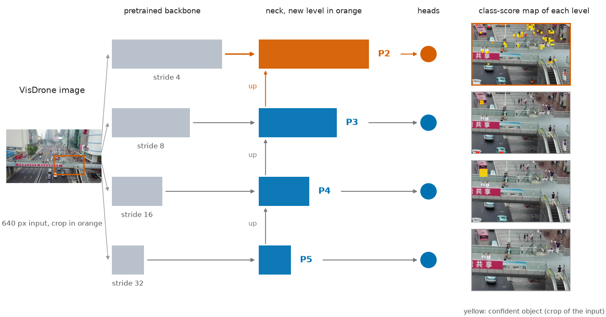
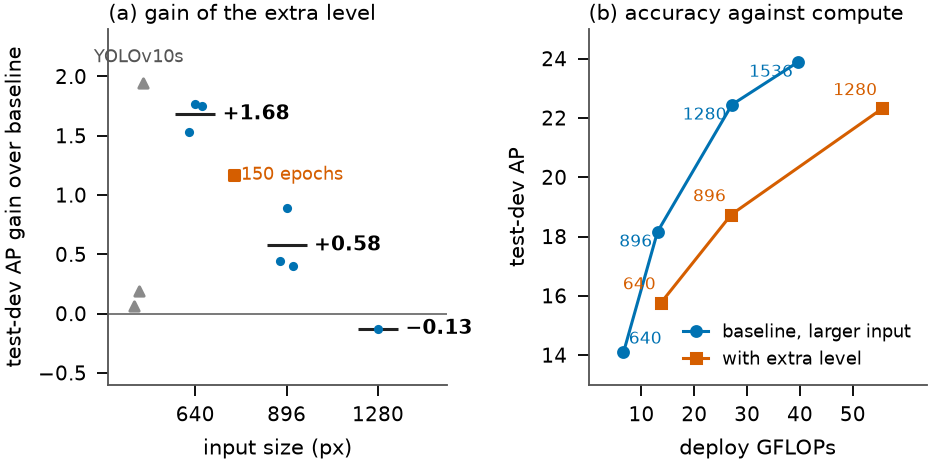
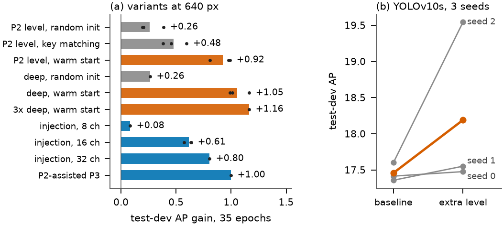
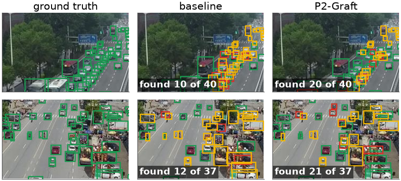
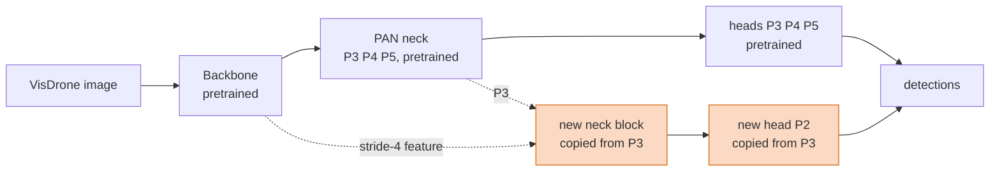

<div align="center">

# P2-Graft

### When does a stride-4 prediction level help a pretrained YOLOv10 on drone images?

[](paper/main.pdf)
[](https://huggingface.co/datasets/mudassiruddin/yolo)
[](https://github.com/VisDrone/VisDrone-Dataset)
[](#reproduce)



*Quratulain Nayeem, Fahmina Taranum, Mohammed Mudassir Uddin, Sara Rizwan*

</div>

A stride-4 branch is grafted onto a pretrained YOLOv10 so that the original outputs are unchanged at the start, and the new branch is initialised from the pretrained stride-8 weights.
The repository contains the paper, the single notebook that ran every experiment, the per-run results of all 51 reported runs, and the scripts that make every figure and table.

**Jump to:** [Results](#results) · [How it works](#how-it-works) · [Published results](#against-published-results) · [Reproduce](#reproduce) · [Repository map](#repository-map)

---

## Results

All numbers are AP on **VisDrone test-dev** (primary) with validation AP beside it. One recipe, one GPU, last-epoch weights, gains paired by seed.

| Setting | Baseline | P2-Graft | Gain | Seeds |
|---|---|---|---|---|
| YOLOv10n, 640 px, 90 epochs | 14.09 | **15.77** | **+1.68** | 3 |
| YOLOv10n, 896 px, 90 epochs | 18.16 | **18.74** | **+0.58** | 3 |
| YOLOv10n, 1280 px, 90 epochs | 22.45 | 22.32 | **−0.13** | 1 |
| YOLOv10n, 640 px, 150 epochs | 14.46 | **15.63** | **+1.17** | 1 |
| YOLOv10s, 640 px, 90 epochs | 17.46 | **18.19** | **+0.73** | 3 |

<p align="center"></p>

> **Reading the table.** The extra level helps most at 640 px and the gain shrinks as the input grows. At equal GFLOPs a plain baseline at a higher resolution is more accurate
> (baseline at 896 px, 13.0 GFLOPs: 18.16; P2-Graft at 640 px, 13.7 GFLOPs: 15.77). On YOLOv10s the per-seed gains are +0.06, +0.19 and +1.94, so the mean rests on one seed.

<details>
<summary><b>What matters inside the branch</b> (35 epochs, 640 px, YOLOv10n)</summary>

| Variant | Seeds | GFLOPs | Test-dev AP | Gain |
|---|---|---|---|---|
| baseline | 3 | 6.6 | 13.46 | – |
| P2 level, random init | 3 | 12.7 | 13.72 | +0.26 |
| P2 level, key-matched weights | 3 | 12.7 | 13.94 | +0.48 |
| P2 level, warm start | 3 | 12.7 | 14.39 | **+0.92** |
| 2× deeper block, warm start (**P2-Graft**) | 3 | 13.7 | **14.52** | **+1.05** |
| detail injection, 16 channels | 3 | 6.9 | 14.08 | +0.61 |

<p align="center"></p>

The warm start (copying the pretrained stride-8 block and head into the new level) is what makes the branch useful; depth only helps together with it.
</details>

<details>
<summary><b>Qualitative examples</b> (validation crops)</summary>

<p align="center"></p>

Green: match, red: false alarm, yellow: missed. The crops are the two with the largest gain in found objects, so they show the best case.
</details>

## How it works



* No existing layer reads the new branch, so the three original levels give exactly the pretrained outputs at the start (maximum difference 0, checked for YOLOv10n and YOLOv10s).
* The new block and head start as copies of the P3 block and head wherever tensor shapes agree (0.22 M parameters); the model called P2-Graft repeats the block twice.
* The variant was chosen on validation AP among five candidates; test-dev was never used for a decision.

## Against published results

Validation AP on VisDrone. Other works are quoted from their papers (their own schedules, e.g. 300 epochs for FBRT-YOLO); ours are 90-epoch runs. **Ours in bold.**

| Model | Input | Params (M) | AP | AP<sub>50</sub> |
|---|---|---|---|---|
| YOLOv8-N | 640 | 3.2 | 19.6 | 33.3 |
| FBRT-YOLO-N | 640 | 0.9 | 20.2 | 34.4 |
| YOLOv10-S | 640 | 7.2 | 23.8 | 39.3 |
| FBRT-YOLO-S | 640 | 2.9 | 25.9 | 42.4 |
| DroneScan-YOLO | 1280 | 10.23 | 35.6 | 55.3 |
| **P2-Graft, YOLOv10n** | **640** | **2.41** | **20.64** | **35.96** |
| **P2-Graft, YOLOv10s** | **640** | **7.58** | **23.29** | **39.86** |
| **YOLOv10n baseline** | **1536** | **2.27** | **30.29** | **49.42** |

Sources: [FBRT-YOLO (AAAI 2025)](https://arxiv.org/abs/2504.20670) for YOLOv8-N, YOLOv10-S and FBRT-YOLO; [DroneScan-YOLO](https://arxiv.org/abs/2604.13278).

## Reproduce

<details>
<summary><b>Run the notebook</b></summary>

```bash
pip install "marimo>=0.14" ultralytics==8.4.150 pycocotools faster-coco-eval tidecv pandas scipy pyyaml requests matplotlib pillow psutil tqdm huggingface_hub
marimo edit code/graft_p2_v2.py        # needs an NVIDIA GPU; downloads VisDrone-DET2019 (about 2 GB)
```

Pick a session in the first cell, paste an optional Hugging Face token (write access to your own dataset repo) and press **START**.

| Session | Runs | Question |
|---|---|---|
| A | model and baseline, 896 px, 3 seeds | does the gain hold at 896 px? |
| B | 1280 px, 150-epoch schedule, batch-32 control | does it survive the best resolution and longer training? |
| C | YOLOv10s, 3 seeds | does it replicate at a second model scale? |

The notebook trains in a background worker, pushes results and checkpoints to the dataset repo every 10 minutes, pauses at the end of the session budget and resumes from the saved checkpoints
(enter the folder name in the RESUME field). It writes `results/leaderboard.csv`, `contrasts.csv` (image-bootstrap intervals) and `all_runs.csv`.
</details>

<details>
<summary><b>Rebuild the figures, tables and paper</b></summary>

```bash
ARCHIVE=/path/to/raw/results python code/make_final_runs.py   # curated run table from the raw result files
python code/make_tables.py && python code/make_figures.py       # paper/tables, paper/figures
cd paper && tectonic main.tex                                   # or pdflatex + bibtex (Springer llncs class)
```
</details>

All 51 runs ran on one NVIDIA RTX PRO 6000 Blackwell GPU (PyTorch 2.11, Ultralytics 8.4.150). Trained weights and per-run results:
**[huggingface.co/datasets/mudassiruddin/yolo](https://huggingface.co/datasets/mudassiruddin/yolo)**.

## Repository map

```
paper/      main.tex, references.bib, main.pdf, figures/, tables/
code/       graft_p2_v2.py (the notebook), make_final_runs.py, make_tables.py, make_figures.py
results/    runs_summary.csv (51 runs), final_runs.csv (all metrics), contrasts_session_{A,B,C}.csv
assets/     images used in this README
```

## Licence and data

Ultralytics is released under AGPL-3.0 and the trained models derived from it keep that licence. VisDrone images and annotations are distributed by their authors for research use and are not included here. The licence of the code in this repository is left to the authors to set.
